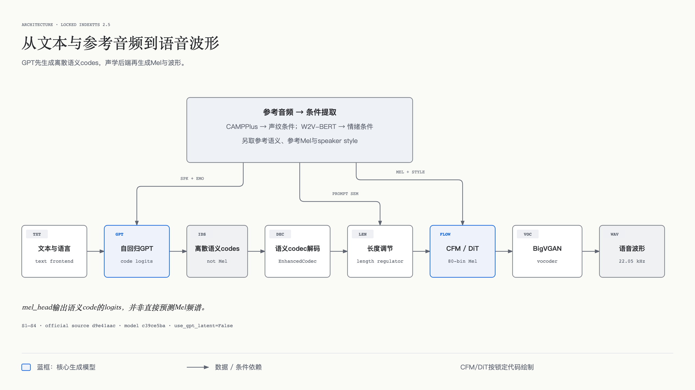
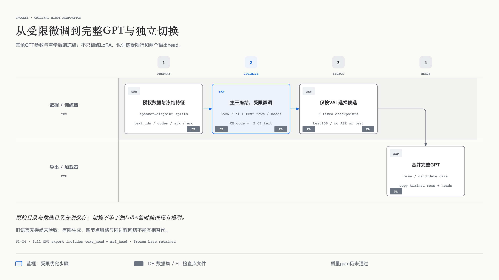

# 为什么在 IndexTTS 2.5 的 GPT 上做 Hindi 微调

本次实验先适配“Hindi 文字如何变成语音语义 token”，保留已有的语义解码、声学模型和声码器。这样可以把有限数据集中到文字与发音的映射，并减少同时改动多个生成阶段带来的不确定性。这是根据实际接口作出的实验选择，不是官方给出的 Hindi 微调配方，也不证明冻结的后端已经充分覆盖 Hindi。

公开的 best100 是**合并后的完整 GPT 子模型**，训练时使用了 LoRA；它不是运行时另挂的一份纯 LoRA，也不是整套声学模型。下文区分作者论文、固定发布代码和本项目原创训练实现，不把一个层面的结论当成另一个层面的验收。

## 证据和版本范围

| 证据 | 能说明什么 | 本文采用的边界 |
|---|---|---|
| [IndexTTS2 论文 v2](https://arxiv.org/abs/2506.21619v2) | 2.0 的自回归时长控制、speaker/emotion 条件设计 | 不能据此宣称本次 2.5 Hindi 实验具备同等控制或质量 |
| [IndexTTS 2.5 技术报告 v5](https://arxiv.org/html/2601.03888v5) | 2.5 的多语言建模、语义序列压缩、声学架构和 RL 后训练描述 | 是作者的系统报告；本次没有复现其完整训练、GRPO 或报告指标 |
| [官方源码 d9e41aac](https://github.com/index-tts/index-tts/tree/d9e41aac89fd00b3d71497fddb287b7f24613712) 与 [模型配置 c39ce5b](https://huggingface.co/IndexTeam/IndexTTS-2.5/blob/c39ce5ba981572cb187443877ff559dfb246ce63/config.yaml) | 本次权重对应的构造参数、推理调用和张量接口 | 实现细节以这组固定版本为依据，不能凭“2.5”目录名判断 |
| [本项目原生实现 7c950e3](https://github.com/allenflux/indextts25-hindi-h200/tree/7c950e32597b09ac51405f16d9e1dfc87aded98b/src/hi_h200_native) | 实际训练参数、特征、loss、合并与校验 | 是原创实验实现，不是官方 trainer 或社区后端的复制品 |

这里有一个必须保留的版本差异：2.5 报告描述以 Zipformer 替换 S2M 的 U-DiT；但本次固定配置的 `s2mel.dit_type` 为 `DiT`，实际代码由 `CFM` 构造 `diffusion_transformer.DiT`，后者使用 `gpt_fast.Transformer`。在这条固定路径中未找到显式 Zipformer 构造。本文按实际接口称其为 **CFM/DiT 声学后端**，不擅自把报告名称套入本次结构，也不据此判断官方实现有 bug。[实际构造](https://github.com/index-tts/index-tts/blob/d9e41aac89fd00b3d71497fddb287b7f24613712/indextts/s2mel/modules/flow_matching.py#L163)、[DiT 内部](https://github.com/index-tts/index-tts/blob/d9e41aac89fd00b3d71497fddb287b7f24613712/indextts/s2mel/modules/diffusion_transformer.py#L103)

另一个容易混淆的文件名是 `model_v2.py`：固定 `infer_v2_5.py` 实际从该文件导入 `UnifiedVoice`，并非因为文件名含 v2 就是在运行 2.0 权重。必须结合实际配置、权重 revision 和哈希判断。[2.5 入口](https://github.com/index-tts/index-tts/blob/d9e41aac89fd00b3d71497fddb287b7f24613712/indextts/infer_v2_5.py#L20)

## 固定版本实际上如何合成语音

图按本次固定代码分组；参考条件不是同一个向量。可编辑[HTML源](diagrams/indextts25-inference.html)与[来源及保真账本](diagrams/SOURCES_AND_FIDELITY.md)一并保留。

“semantic code” 是从语音表征量化得到的离散编号，不是文字字符、音素标签或最终波形采样点。代码里沿用 `mel_codes`、`mel_head` 的名称，也不能据此把 GPT 的输出理解成连续 mel 频谱。

| 环节 | 本次实际接口与数据 | 它承担的工作 |
|---|---|---|
| 文字与语言 | tokenizer 编码语言前缀和文字；另有 `lang_embedding` | 给文字内容和目标语言提供条件 |
| 自回归 GPT | `UnifiedVoice.inference_speech` 逐步预测离散 codes，遇停止 token 结束 | 学习内容、发音顺序及语义序列的组织 |
| 语义解码 | `EnhancedCodec.decode(codes)` 返回连续语音表征 | 将离散 codebook 编号恢复为后端可用特征，不直接输出 WAV |
| 长度适配 | `length_regulator(..., ylens=target_lengths)` | 将语义特征调整到声学帧长度，形成声学条件 |
| 语义到 mel | `cfm.inference` 使用条件、参考 mel、speaker style 和噪声 | 用条件流匹配及其 DiT 估计器生成 mel 频谱 |
| mel 到波形 | `bigvgan(vc_target.float())` | 将 80 通道 mel 转为 22,050 Hz 波形；之后才拼段、处理间隔和保存 PCM |

这张接口表对应实际推理调用，不是把论文图重新命名。[code 解码至波形的调用点](https://github.com/index-tts/index-tts/blob/d9e41aac89fd00b3d71497fddb287b7f24613712/indextts/infer_v2_5.py#L824)、[codec](https://github.com/index-tts/index-tts/blob/d9e41aac89fd00b3d71497fddb287b7f24613712/indextts/codec/models.py#L180)、[length regulator 构造](https://github.com/index-tts/index-tts/blob/d9e41aac89fd00b3d71497fddb287b7f24613712/indextts/s2mel/modules/commons.py#L390)

本次 `MyModel` 使用默认 `use_gpt_latent=False`，上述后端调用没有另行接入 GPT hidden latent。不能把 2.0 论文中的 latent 增强训练描述，直接写成本次 2.5 接口已经采用的额外输入。[实际模块选择](https://github.com/index-tts/index-tts/blob/d9e41aac89fd00b3d71497fddb287b7f24613712/indextts/s2mel/modules/commons.py#L407)

### 文字、语言槽位与 Hindi

固定配置的 GPT 为 24 层、维度 1280、20 个 attention heads；文字容量参数为 60,509，语义 codebook 为 8,192，另有开始/停止编号 8192/8193，分类输出为 8,194。实际文字 embedding/head 构造还包含额外一行，不能只根据配置字段名推断矩阵形状。[固定配置](https://huggingface.co/IndexTeam/IndexTTS-2.5/blob/c39ce5ba981572cb187443877ff559dfb246ce63/config.yaml)、[构造代码](https://github.com/index-tts/index-tts/blob/d9e41aac89fd00b3d71497fddb287b7f24613712/indextts/gpt/model_v2.py#L305)

有两种不同的语言标记：文字 tokenizer 中的 `<|hi|>`，以及 `lang_embedding` 中的 Hindi 行 17。两者属于不同编号空间，不能把“语言行17”当作“文字 token ID 17”。`prepare_gpt_inputs` 组装文字边界、位置 embedding，并把语言 embedding 加到文字 embedding 上；本项目沿用该公开方法。[语言表与 special token](https://github.com/index-tts/index-tts/blob/d9e41aac89fd00b3d71497fddb287b7f24613712/indextts/utils/tokenizer.py#L9)、[输入组装](https://github.com/index-tts/index-tts/blob/d9e41aac89fd00b3d71497fddb287b7f24613712/indextts/gpt/model_v2.py#L648)

接口能表示 Hindi，不等于模型已被官方充分训练或评测为支持 Hindi。固定官方 README 声明的目标语言是中文、英语、日语、西班牙语和阿拉伯语；本项目的 Hindi 是额外实验。保守 NFC/空白处理保留 nukta、virama、组合标记和 joiner；不能靠删除这些字符消除输入错误。具体数据和前端约束见 [DATA](DATA.md) 与 [NATIVE](NATIVE.md)。[官方语言声明](https://github.com/index-tts/index-tts/blob/d9e41aac89fd00b3d71497fddb287b7f24613712/README.md#L18)

### 参考音频如何影响音色和情绪

同一参考音频存在两类不同特征。CAMPPlus 从 16 kHz 音频的 filterbank 提取 192 维全局 speaker/style 向量；GPT 将其投影为 1280 维 speaker 条件，声学后端也使用该 style。另一条 w2v-BERT 分支取第17层、按发布统计量标准化的 1024 维连续表征，用于参考条件与 GPT 的 emotion 编码。它们不是同一个向量。[参考处理](https://github.com/index-tts/index-tts/blob/d9e41aac89fd00b3d71497fddb287b7f24613712/indextts/infer_v2_5.py#L621)、[语音表征](https://github.com/index-tts/index-tts/blob/d9e41aac89fd00b3d71497fddb287b7f24613712/indextts/infer_v2_5.py#L280)

在本次 CAMPPlus 模式中，GPT 条件前缀包含“投影后的 speaker 向量加 emotion 向量”，后接两个零条件位。情绪音频可单独提供；未提供时，官方入口使用 speaker 参考作为情绪参考。`merge_emovec` 按 alpha 线性混合参考情绪向量，函数自身不夹紧 alpha，只有0–1范围严格属于插值；可选的情绪文本路径需要另行加载 QwenEmotion，本次 Hindi 训练没有微调该 Qwen 模块。向量设计表达了分离控制的意图，不保证 Hindi 音色、情绪已完全独立或保持不变。[GPT 条件](https://github.com/index-tts/index-tts/blob/d9e41aac89fd00b3d71497fddb287b7f24613712/indextts/gpt/model_v2.py#L740)、[情绪组合](https://github.com/index-tts/index-tts/blob/d9e41aac89fd00b3d71497fddb287b7f24613712/indextts/gpt/model_v2.py#L827)

声学 CFM 还得到参考 mel 和经长度适配的参考语义条件。其推理从噪声开始，使用估计器和固定步数的 Euler 积分生成 mel，再去掉参考段。这不是 GPT 输出离散 code 后直接查表播放。[CFM 推理](https://github.com/index-tts/index-tts/blob/d9e41aac89fd00b3d71497fddb287b7f24613712/indextts/s2mel/modules/flow_matching.py#L29)

### 时长控制的实际边界

语义序列长度影响声学时长，但 `max_mel_tokens` 是生成上限，不是“必须说完”或“精确生成某秒”的保证。本次入口到达上限而未出现停止 token 时会警告。后端按 `int(decoded_length × 1.72 × duration_factor)` 设置 mel 目标帧数；长度调节、分段、间隔和结束行为仍会影响最终 WAV。[长度和停止检查](https://github.com/index-tts/index-tts/blob/d9e41aac89fd00b3d71497fddb287b7f24613712/indextts/infer_v2_5.py#L792)

2.0 论文提出的时长控制不能直接作为本次 Hindi 精确时长的证据。本次 CAMPPlus 条件路径的两个占位是零向量，不是在训练一套新的 Hindi `speed_emb` 或时长预测器；本实验也没有独立时长回归损失。

## 为什么先选择 GPT LoRA，并冻结后端

选择依据是接口与数据规模，而不是“LoRA 自动懂 Hindi”：

1. 新语言首先要求把 Devanagari 文字、语言条件与正确的语音 codes 对齐。GPT 正好处在这个映射的位置；已授权的成对文字/录音可以通过冻结编码器给出训练标签。
2. 固定 codec、声学模型和 BigVGAN，使这次实验在同一个 codebook 与声音生成接口上比较。否则多个阶段同时变化，很难定位文字识别、语义生成和声学重建各自的问题。
3. 64 段、16 位 speaker 的 pilot 很小。以低秩 attention 更新限制一部分自由度，是比同时重训整套语音生成器更可控的起点；它不能证明此选择最优，也不能保证冻结后端足以表达全部 Hindi 音系和韵律。
4. 同一原模型与固定候选可以做输入、特征、logits、合并和 WAV 的逐级检查。工程可审计性与语音质量是两类证据，前者通过不替代后者。

这些是本项目的设计理由与待验证假设，没有做“冻结/解冻后端”或不同 LoRA 配方的完整消融，不能把 rank8、alpha16 或损失权重称为官方推荐或最佳值。论文中的 GRPO 后训练也没有在本项目执行。

## 本次究竟更新了哪些参数

图中两条责任lane区分数据/训练与导出/加载；目录切换和质量验收是不同证据。

原生构造先冻结全部基础参数，再明确打开下列部分：[实际训练范围](https://github.com/allenflux/indextts25-hindi-h200/blob/7c950e32597b09ac51405f16d9e1dfc87aded98b/src/hi_h200_native/model.py#L234)

| 部分 | 实际更新范围 | 需要注意 |
|---|---|---|
| GPT attention LoRA | 全24层 attention 的 `c_attn` 和 `c_proj` | 是共享的 QKV/attention 输出投影，不是只作用于 Hindi 的私有网络 |
| 语言 embedding | 仅第17行允许梯度更新 | 其他语言行保护不等于其他语言输出行为不变 |
| 文字 embedding | 训练数据实际出现的 token 行 | 含语言前缀、标点等共用 token，不是“只含 Devanagari 的专属词表” |
| 两个输出 head | `mel_head`、`text_head` 的完整矩阵和 bias | 不是 LoRA 化的两个小 head |
| 其他组件 | GPT 其余基础参数、speaker/emotion 编码与投影、codec、w2v-BERT、CAMPPlus、CFM/DiT、BigVGAN 均保持冻结 | 本次不是声学全模型或端到端波形训练 |

因此不能把本次简称为“只训练少量 LoRA”或据 rank8 推断模型包和优化器的大小。两个 head 是全量更新；embedding 虽做行梯度 mask，仍是整张参数 tensor 参与优化器管理。代码将这些 embedding 的 weight decay 设为0，并检查受保护行/基础权重未变，避免零梯度行被衰减。这些保护约束的是参数身份，不保证生成语音无退化。[优化器分组和状态保护](https://github.com/allenflux/indextts25-hindi-h200/blob/7c950e32597b09ac51405f16d9e1dfc87aded98b/src/hi_h200_native/model.py#L272)

### 训练标签与两路损失

每段真实录音先经冻结 w2v-BERT 第17层和 semantic codec 提取离散 code 标签。CAMPPlus 产生 speaker 特征，冻结 GPT 的 emotion 分支产生情绪条件；它们不是人工标注的 emotion 真值。本项目提取配方为完整目标音频 24 kHz 直接重采样16 kHz，参考条件最多取15秒；它与官方推理中先经 librosa 默认采样路径的数值并非全前端等价。[原生提取](https://github.com/allenflux/indextts25-hindi-h200/blob/7c950e32597b09ac51405f16d9e1dfc87aded98b/src/hi_h200_native/extract.py#L243)

一个训练样本使用目标的 text/codes 与 emotion 特征，而 speaker 向量取自同 split、同 speaker 的另一段不同 clip。数据加载器会检查这个配对；验证 speaker 与训练 speaker 隔离。[真实配对](https://github.com/allenflux/indextts25-hindi-h200/blob/7c950e32597b09ac51405f16d9e1dfc87aded98b/src/hi_h200_native/data.py#L231)

训练采用 batch1、无 padding 的 teacher forcing：模型读入前面的真实 code，预测下一个 code；语义标签末尾加入停止 token。文本 head 同时做下一 token 的辅助预测。两项都是各自序列上取平均的交叉熵，本次计划为：

`L = CE_semantic_code + 0.2 × CE_text`

这里 `mel_head` 分类的是离散语义 codes，**没有 mel 频谱重建 loss**；本次也没有 CFM 流匹配、codec 重建、vocoder GAN、ASR 奖励或 speaker-similarity loss。`NativeHindiModel` 构造默认 text 权重为0.1，但训练配置和本次 pilot 使用0.2；不能用函数默认值代替实际计划。0.2 是固定实验起点，尚无消融证明它优于其他值。[真实 loss 和 targets](https://github.com/allenflux/indextts25-hindi-h200/blob/7c950e32597b09ac51405f16d9e1dfc87aded98b/src/hi_h200_native/model.py#L339)、[配置](https://github.com/allenflux/indextts25-hindi-h200/blob/7c950e32597b09ac51405f16d9e1dfc87aded98b/configs/native-train.example.json#L23)

Teacher forcing 的 loss 下降只表明在给定真实前文与条件时更容易预测标签。实际推理必须不断使用自己生成的 codes；早期错误、重复或过早停止可能累积，因此训练 loss 不能代替完整语音和独立文本验收。

## LoRA 如何合并成普通 GPT 权重

对输入 `x`，本项目低秩分支的推理形式为 `base(x) + (alpha/r) × B(A(x))`；导出在 eval 模式关闭 LoRA dropout。本实现包装的是 Hugging Face `Conv1D`，其权重存储方向为 `[input, output]`，而 `A` 为 `[rank, input]`、`B` 为 `[output, rank]`，因此实际合并为：

`W_merged = W_base + (alpha/r) × AᵀBᵀ`

bias 保留，更新后的两个 head、语言/文字行及其余完整官方状态一起写入 `{"model": state_dict}`。导出移除 LoRA wrapper 名称，并按真实官方构造器严格核对全部 key、shape 和 dtype；不是只给原权重附加一个低秩文件。[LoRA 前向](https://github.com/allenflux/indextts25-hindi-h200/blob/7c950e32597b09ac51405f16d9e1dfc87aded98b/src/hi_h200_native/model.py#L184)、[合并实现](https://github.com/allenflux/indextts25-hindi-h200/blob/7c950e32597b09ac51405f16d9e1dfc87aded98b/src/hi_h200_native/export.py#L48)

合并后的推理不再需要运行时 LoRA 节点。但完整 GPT 仍依赖同版本的其他声学资产；公开13文件包不能替代整套 IndexTTS 2.5 目录。原生 adapter、完整合并 GPT 与含 optimizer/RNG 的训练 checkpoint 也不能混用。操作和校验见 [EXPORT](EXPORT.md)、[NATIVE](NATIVE.md)。

## 为什么保留旧语言回归，以及 best100 证明了什么

即使只开放 Hindi 语言行，LoRA attention 与两个输出 head 仍服务所有语言，共用文字行也可能更新。冻结后端并不消除这种分布变化：生成 codes、结束位置、韵律和条件利用方式都可能改变，进而改变最终声音。保留原模型、分目录登记模型身份并做旧语言回归，是由共享参数结构直接推导出的必要检查，而不是“已经证明零退化”的声明。

本次 pilot 为64 clips、16 speakers，按 speaker 分为 train48/12人、val8/2人、test8/2人；这些分组来自已授权 IndicVoices-R Hindi 的官方 TRAIN 分片，test 是本项目内部 held-out 分组，不是发布者官方 TEST。它从原始 base 独立训练，原计划最大1000 updates保持不变；先停20，再新进程恢复至500。五个验证点中 step100 的 loss 最低，随后升高，故按 VAL 选择并冻结 best100；后来的 test/ASR 不用于重选。[训练与选择记录](../VALIDATION.md)、[checkpoint 选择流程](CHECKPOINT_SELECTION.md)

冻结后的两条 Hindi test，候选严格 CER 为50%；ASR 对真人 reference 本身也有误差。旧五语言各一例使用 Hindi prompt 的 stress 不是 native-prompt 全面回归，中文和日文单例出现识别差异。完整 GPT 的单 feature FP32 parity、真实 WAV、5090 隔离节点功能通过，都不能扩张为全部数据前端等价、母语听评、同进程回切或生产质量通过。当前原模型保留，实验标识与未通过项见 [有限验收](FINITE_ACCEPTANCE.md)、[5090范围](RTX5090_SWITCHING.md) 和 [模型卡](MODEL_CARD.zh.md)。

本说明解释的是已锁定的模型与实验决策，不新增数据、说话人或模型的用途授权；原始协议与数据归属继续适用。
